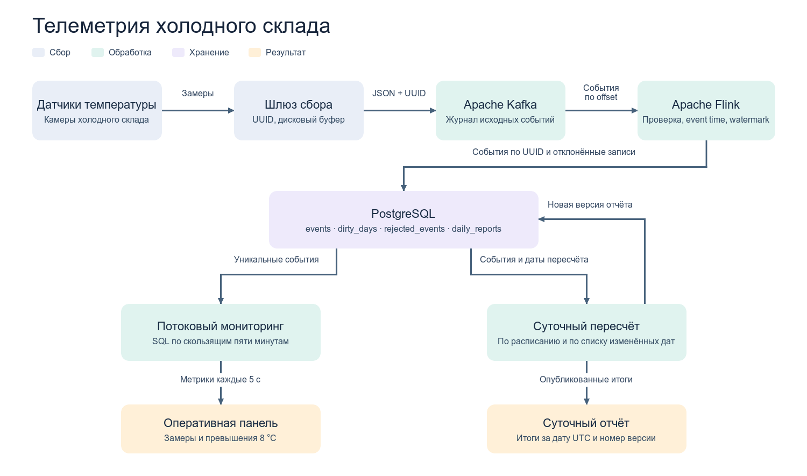

# Отчёт по практической №2

## 1. Вариант и задача

| Поле | Значение |
| --- | --- |
| ФИО (как в VK Education) | Ширков Стёпа |
| Тема | Вариант 2 — «Поток событий без потерь» (Streaming vs Batch) |
| Состав решения | Датчики, шлюз, Apache Kafka, Apache Flink, PostgreSQL, оперативная панель и суточный отчёт |
| Данные, объём | Пример для проекта: 500 датчиков по одному замеру в минуту. Это 720 000 измерений в сутки и около 180 МБ исходных JSON в сутки при 250 байтах на сообщение, без учёта индексов и репликации. |

На холодном складе сотрудники смотрят число измерений и превышений 8 °C за последние пять минут. Руководителю нужны те же показатели за каждые сутки. Из-за перебоев связи шлюз может отправить замер позже или повторить отправку. В отчёте замер должен появиться ровно один раз и относиться к дате фактического измерения.

## 2. Источники и способы сбора

| Источник | Тип | Способ сбора |
| --- | --- | --- |
| Датчики температуры в холодильных камерах | Поток IoT | Шлюз принимает замеры и записывает их в локальный дисковый буфер. При первом сохранении шлюз присваивает событию UUID и сохраняет его для всех повторных отправок. |
| Топик Kafka `temperature.raw` | Поток исходных событий | Flink читает записи по смещениям. Kafka позволяет перечитать их после сбоя, пока они есть в журнале. Ключ партиционирования — `sensor_id`. |
| Таблицы PostgreSQL `events` и `dirty_days` | События и список дат для batch-пересчёта | Планировщик запускает SQL по расписанию и при появлении новых событий за опубликованные даты. Панель берёт данные из той же таблицы `events`. |

В исходном сообщении передаются `event_id`, `sensor_id`, `event_time` и `temperature_c`. При записи в базу добавляется `ingested_at`. Для времени используется `timestamptz`, для отбора по интервалу — индекс по `event_time`. Время события берётся из часов датчика, а время приёма помогает измерять задержку. Сутки считаются по UTC, от 00:00 включительно до 00:00 следующего дня исключительно.

## 3. Архитектура (Draw.io)



[Редактируемая схема Draw.io](architecture.drawio)

### Lambda или Kappa

В Lambda потоковая и пакетная ветки отдельно обрабатывают исходные данные. Этот подход пригодился бы, если бы бизнес хранил всю сырую историю в отдельном архиве и регулярно строил по ней независимые витрины. Тогда пришлось бы поддерживать одинаковые правила обработки в двух ветках.

Здесь я выбрал подход Kappa. Kafka хранит исходные события, а одна задача Flink обрабатывает как новые сообщения, так и повторное чтение. Поток очищается и записывается один раз по единым правилам. Суточная задача выполняет SQL-агрегацию по уже подготовленной таблице `events`. Так панель и отчёт используют одинаковую базу измерений.

### Event time, поздние события и дубли

- **Event time.** Для отчёта используется `event_time`. Если замер сделан 20 ноября в 23:59, а пришёл 21 ноября в 08:10, он относится к 20 ноября. Для расчётов по времени поступления используется `ingested_at`.
- **Запоздание.** Для каждой активной партиции Flink берёт максимальное наблюдаемое время события минус две минуты. Общий watermark равен минимуму по этим партициям. Простаивающие партиции временно исключаются из расчёта. Записи с временем до текущего watermark прибавляют счётчик запоздавших. PostgreSQL получает все валидные события независимо от watermark. Если замер ещё попадает в последние пять минут, его учтёт ближайшее обновление панели. Более старый замер попадёт в отчёт за свою дату.
- **Дубли.** PostgreSQL хранит `event_id` как первичный ключ. Повторная доставка тех же данных приводит к `ON CONFLICT (event_id) DO NOTHING`. Если под тем же UUID пришёл другой замер, Flink сохраняет его в `rejected_events` для разбора и оставляет первую принятую запись. Невалидные сообщения также сохраняются в этой таблице с причиной и координатами в Kafka.
- **Альтернативы.** Дедупликация в состоянии Flink по UUID с TTL сэкономила бы запросы к базе, но повтор после истечения TTL мог бы пройти. Для точного отчёта я оставил проверку в постоянной таблице. Для поздних событий можно держать окно открытым ещё несколько минут, а более старые события выводить в отдельный поток и пересчитывать. В моей схеме все корректные события сразу сохраняются, а отчёт пересчитывается только за затронутую дату.

### Восстановление и пересчёт

Шлюз удаляет запись из дискового буфера после подтверждения от Kafka. Для основного контура я бы настроил `acks=all`, идемпотентного producer и три реплики топика с `min.insync.replicas=2`. Исходный топик хранится 30 дней. Запас места и задержку чтения нужно отслеживать, чтобы успеть восстановиться до истечения срока хранения.

Задача Flink сохраняет состояние и смещения в checkpoint. Записи в PostgreSQL должны завершиться или быть сохранены в таблице отклонений до подтверждения соответствующего checkpoint. Если транзакция в PostgreSQL успеет завершиться, а checkpoint потеряется, Flink может прочитать сообщение ещё раз. Первичный ключ не даст задвоить результат. Рабочий сценарий опирается на сохранность буфера и реплик и восстановление в пределах срока хранения Kafka.

При вставке нового события PostgreSQL в той же транзакции добавляет его дату в `dirty_days`. Каждый день в 06:00 UTC планировщик публикует первую версию отчёта за вчера. Затем каждые пять минут он проверяет пометки для уже опубликованных дат. На одной дате загрузка и пересчёт берут одну транзакционную блокировку, чтобы новый замер не потерял пометку при одновременной обработке. Пересчёт заменяет итоговую строку за дату и снимает пометку в одной транзакции. Если значения изменились, номер версии увеличивается.

## 4. Docker — что поднялось

| Блок | Статус |
| --- | --- |
| Источник событий | Реализован тестовый набор с дублями, доставкой не по порядку и запоздалым измерением. |
| Хранение и дедупликация | Реализованы на SQLite в демонстрации. Файл базы переживает закрытие и повторное открытие соединения. |
| Оперативный расчёт и суточный пересчёт | Реализованы в `demo.py`. Программа проверяет окно за пять минут, первую версию отчёта, исправление и повторную доставку. Время задаётся тестовыми данными. |
| Kafka, Flink и PostgreSQL | Спроектированы на схеме. В демонстрационном стенде их заменяют тестовый источник, Python и SQLite. |
| Compose | Конфигурация прошла `docker compose config`. Подключение к Docker Engine не установилось, поэтому контейнер и его статус через `docker ps` не проверены. |

Файлы стенда: [docker-compose.yml](docker-compose.yml) и [demo.py](demo.py). Контейнер выполняет сценарий один раз и завершает работу.

```bash
docker compose config
docker compose up --abort-on-container-exit --exit-code-from demo
docker ps -a
docker compose ps -a
```

При попытке запуска Docker сообщил `failed to connect to the docker API`. Локальный запуск `python3 demo.py` завершился успешно. Выдержка из его вывода:

```text
Мониторинг за 5 минут на 00:05 UTC: 1 измерение, выше 8 °C 0
Сутки 2026-11-20: измерений 2, выше 8 °C 1, версия 1
После переподключения к сохранённой базе:
e-104: 2026-11-20T23:59:00Z → приём 2026-11-21T08:10:00Z → записано
Сутки 2026-11-20: измерений 3, выше 8 °C 2, версия 2
e-104: 2026-11-20T23:59:00Z → приём 2026-11-21T08:10:00Z → повтор
Сутки 2026-11-21: измерений 1, выше 8 °C 0, версия 1
Все проверки пройдены.
```

## 5. Описание пути данных

| Шаг | Для чего | Результат |
| --- | --- | --- |
| 1. Датчик измеряет температуру, шлюз сохраняет событие | Пережить перебой связи и не менять UUID при повторе | Замер с временем измерения и постоянным идентификатором |
| 2. Шлюз отправляет сообщение в Kafka | Хранить исходные события и восстанавливать обработку | Реплицируемый журнал, который можно перечитать |
| 3. Flink проверяет сообщение и присваивает временной отметке смысл event time | Различать фактическое время, задержку и ошибки формата | Корректные события для записи и отклонённые записи для разбора |
| 4. PostgreSQL сохраняет событие по UUID и отмечает дату | Учесть замер один раз и запомнить, что предыдущий итог мог измениться | Уникальная строка в `events` и дата в `dirty_days` для нового события |
| 5. Панель обновляет запрос каждые пять секунд | Быстро увидеть число замеров и превышений | Оперативные показатели за последние пять минут |
| 6. Планировщик считает и при необходимости пересчитывает сутки | Учесть замеры, пришедшие после первой публикации | Версия отчёта за календарную дату UTC |

## 6. Выводы

Я выбрал один поток подготовки данных и две частоты расчёта. Оперативная панель нужна, чтобы быстро увидеть отклонение, а суточный отчёт можно исправить после получения запоздалого замера. В проверке замер в 23:59 увеличил число измерений за 20 ноября с двух до трёх. Его повторная доставка оставила вторую версию отчёта без изменений.

При проектировании я понял, что восстановить чтение из Kafka и избежать дублей в базе — две отдельные задачи. Для первой нужны сохранённые смещения, а для второй — постоянный идентификатор и повторяемая запись.

## Мой любимый десерт

Чизкейк «Нью-Йорк». Больше всего нравится сочетание сливочной начинки и песочной основы.

## Источники

- [Условия и форма практической №2](https://github.com/m1705161/p2)
- [Apache Kafka — параметры producer](https://kafka.apache.org/41/configuration/producer-configs/)
- [Apache Flink — event time и watermarks](https://nightlies.apache.org/flink/flink-docs-stable/docs/sql/reference/ddl/create/)
- [PostgreSQL — INSERT и ON CONFLICT](https://www.postgresql.org/docs/16/sql-insert.html)
